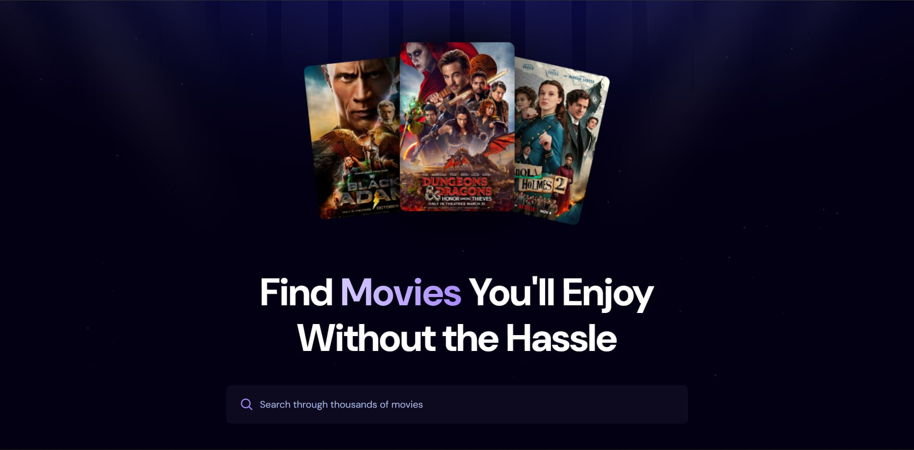
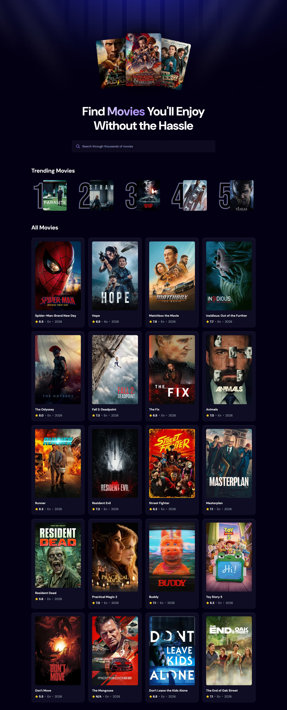
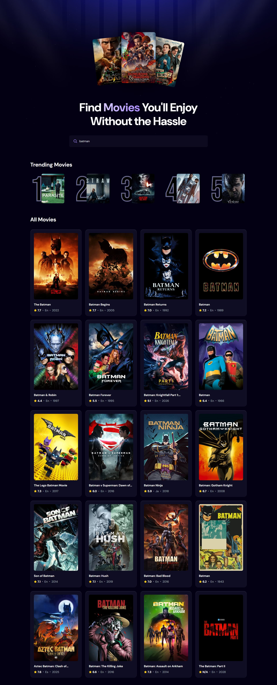

# React Movie Hub

A movie discovery app built with React, Vite, and Tailwind CSS. It pulls movie data from the TMDB API and uses Appwrite to track searches and surface trending titles.

**Status:** Core implementation complete. Independent enhancements in progress.

  

## About

Built while following JavaScript Mastery's React tutorial, this project was my hands-on introduction to component-based architecture, API integration, backend services, and secure configuration. It is the foundation for the features and refinements I plan to add on my own.

## Features

- **Movie discovery:** Browse popular titles with posters, ratings, languages, and release years.
- **Debounced search:** Search by title without flooding the API with requests.
- **Trending movies:** Uses Appwrite search counts to display the five most-searched entries.
- **Resilient UI:** Loading states and error handling for failed movie fetches.

## Screenshots

  <b>Landing page</b>  
  

<table align="center">
  <tr>
    <td width="400" align="center"><b>Full page</b></td>
    <td width="400" align="center"><b>Search results</b></td>
  </tr>
  <tr>
    <td></td>
    <td></td>
  </tr>
</table>

## Tech Stack

| Area             | Tools                           |
| ---------------- | ------------------------------- |
| Frontend         | React, JavaScript, Tailwind CSS |
| Build tool       | Vite                            |
| Data             | TMDB API                        |
| Backend services | Appwrite                        |
| Version control  | Git, GitHub                     |

## What I Learned

- **React fundamentals:** Built reusable components and practiced state management, side effects, and debounced search input.
- **API integration:** Connected the frontend to TMDB to fetch and display movie data, with loading and error states.
- **Database integration:** Used Appwrite to record searches and retrieve trending results based on search counts.
- **Configuration and security:** Used environment variables and learned why local config files and frontend-exposed credentials need careful handling.
- **Git and GitHub workflow:** Practiced incremental commits, conventional commit messages, and documenting progress as the project evolved.

## Roadmap

- [ ] Add dedicated error handling for trending movie retrieval
- [ ] Refactor and refine the codebase as my React skills grow
- [ ] Deploy the app with a public live demo
- [ ] Introduce original features and UI enhancements, documented as they ship

## Credits

This project follows [React JS 19 Full Course](https://www.youtube.com/watch?v=dCLhUialKPQ) by JavaScript Mastery. The original implementation is available at [adrianhajdin/react-movies](https://github.com/adrianhajdin/react-movies). This repository documents my learning progress, and future changes will reflect my own enhancements.

Please review the original repository's license and applicable third-party terms before reusing code or assets.

Movie data and images are provided by [TMDB](https://www.themoviedb.org/). See the [TMDB API Terms of Use](https://www.themoviedb.org/api-terms-of-use).
